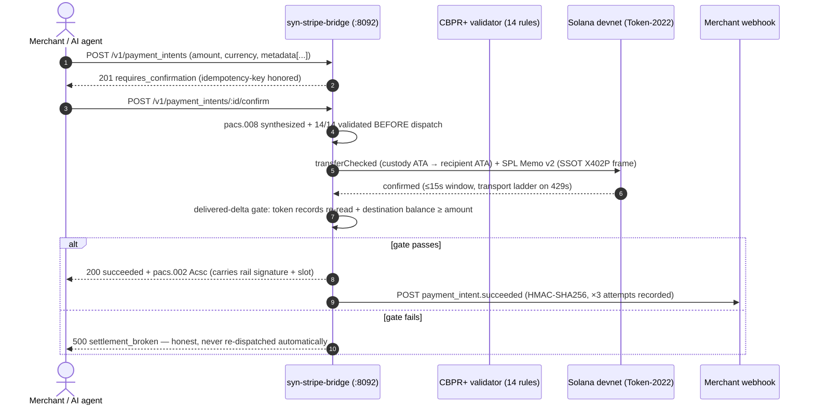

# syn-stripe-bridge

> **The "MinIO / Ollama" for Payments — a drop-in Stripe v1 REST API emulator that settles onto Solana Token-2022 devnet OUSD with ISO 20022 (pacs.008 / pacs.002 CBPR+) wire evidence.**

[](LICENSE)
[](SPECIFICATION.md)

- **Rail:** Solana **devnet** only. OUSD (Token-2022, decimals 6, estate-devnet mint
  `2ANrmtAcMd8eihFGvbyAkrAWveq8nU6uMTigbWBuigNe`). No mainnet rail is wired.
- **State:** offline structural suite 17/17 green; live settlement smoke is
  **custody-gated** (`scripts/smoke_devnet.mjs` refuses honestly when bridge
  custody is unfunded). v0.1's "Implemented & Verified" settlement claims were
  **false**; v0.2 replaces the mock core with real, chain-verified settlement —
  see [SPECIFICATION.md §0](SPECIFICATION.md#0-v01-defects-this-rewrite-closes)
  for the full defect ledger (F1–F9).
- **Custody:** zero. The bridge custody key is read in-process **by path**
  (`BRIDGE_CUSTODY_KEY_FILE`, 0600) and never printed, logged, or committed.

---

## 1. The Core Thesis

In October 2024, Stripe acquired Bridge.xyz for $1.1B — the largest crypto
acquisition — to build stablecoin rails *inside* Stripe's walled garden:
merchants still need bank accounts and KYC, Stripe still charges ~1.5%+ and
holds funds for days, and autonomous AI agents cannot legally use it.

**syn-stripe-bridge is the reverse: Stripe's SDK speaks to chain instead of
to Stripe.** One line of configuration and your existing `stripe-python` /
`stripe-node` code keeps working — PaymentIntent semantics in, ISO 20022 wire
evidence and an on-chain Token-2022 transfer out. There is no custody
intermediary for the merchant's operating balance: the merchant prefunds a
**chain-evidenced prepaid balance** (deposits verified against real ledger
transactions, single-use by signature), and each settlement is one
`transferChecked` leg burning an SWIFT-UETR-carrying SPL Memo v2.

What this drop-in buys (v0.2, devnet):

| Classic Stripe | This bridge |
|---|---|
| Money moves T+1/T+2 payouts | One devnet transaction, confirmed before `200 succeeded` |
| Success = a JSON that says "succeeded" | Success = a **delivered-delta gate**: token records re-read + destination balance re-read ≥ amount, *then* pacs.002 `Acsc` |
| Payment method risk | No payment methods at all: prepaid balance, evidenced on-chain |
| Reconciliation = CSVs | Reconciliation = the memo itself (SSOT `X402P:` grammar), the on-chain tx, and an append-only `receipts.jsonl` |

Fees/finality/chargeback **numbers are deliberately absent** from this README:
devnet settlement cost is fee+rent only measured case-by-case; there is no
production fee schedule to quote yet. Every status this server returns maps to
a gate that actually ran.

## 2. Universal Settlement Grammar

The claim we build on: FINOS FDC3 (PR #2204) StartPayment intents, Stripe
PaymentIntents, and ISO 20022 CBPR+ describe the same movement:

```
FDC3 raiseIntent("StartPayment") ⇔ POST /v1/payment_intents ⇔ pacs.008 CdtTrfTxInf
FDC3 intent id ⇔ Stripe id "pi_syn_…" ⇔ pacs.008 EndToEndId / UETR
FDC3 context parties ⇔ metadata.{debtor,creditor}_{name,bic} ⇔ pacs.008 Dbtr/Cdtr
payment_intent.succeeded ⇔ pacs.002 TxSts "Acsc" ⇔ SPL Memo v2 carrying the SSOT frame
```

The memo is generated **only** by the vendored SSOT (`vendor/discriminators.mjs`,
`buildDeskSettlementMemo(uetr, msgId, baseUnits, "0")`) — the bridge never
hand-writes a memo, and the test suite proves the round-trip.

## 3. Quickstart

```bash
git clone https://github.com/Synaptics-Lab/syn-stripe-bridge.git
cd syn-stripe-bridge
npm i   # (dev runtime deps only — the settlement stack is vendored, no web3.js)

# offline structural suite (mock Solana RPC in-process; no network)
npm test

# provision REAL custody fixtures into the estate vault (0600, paths only)
node scripts/provision_smoke.mjs
```

Boot from env:

```bash
export BRIDGE_CUSTODY_KEY_FILE=/opt/synapticchain/keys/devnet-test/syn-stripe-bridge-custody.key
export BRIDGE_MERCHANTS_FILE=/opt/synapticchain/keys/devnet-test/syn-stripe-bridge-merchants.json
export BRIDGE_DATA_DIR=./data            # append-only receipts.jsonl lives here
export STRIPE_SHIM_PORT=8092
npm start
```

### stripe-python (form-encoded — the real SDK dialect)

```python
import stripe

stripe.api_base = "http://127.0.0.1:8092"      # no /v1 — the SDK appends it
stripe.api_key = "sk_bridge_<your bearer>"     # registry stores only its sha256

# 1) prefund the merchant's prepaid balance with a REAL transferChecked into
#    custody + memo "X402:<merchant_id>"; then hand ONE signature over:
dep = stripe.custom_raw_request(...)  # or plain HTTP POST /v1/deposits
#    POST /v1/deposits  {"signature": "<solana_sig>"}

# 2) create + confirm
intent = stripe.PaymentIntent.create(
    amount=10000,   # $100.00 → 1,000,000,000 raw OUSD units (10000 cents × 10,000)
    currency="usd",
    metadata={
        "solana_recipient": "<solana address>",
        "debtor_name": "Standard Chartered London",
        "debtor_bic": "SCBLGB2LXXX",
        "creditor_name": "GescoPay Lusaka Desk",
        "creditor_bic": "ZABCZMLUXXX",
    },
)
pi  = requests.post(f"{stripe.api_base}/v1/payment_intents/{intent.id}/confirm",
                    auth=("", stripe.api_key)).json()   # or PaymentIntent.confirm()
print(pi["status"], pi["iso20022"]["rail_signature"], pi["receipt_url"])
```

`amount` is mandatory (integer cents ≥ 1 — **no defaults**, ever), `currency`
must be `usd`, all four ISO party fields are mandatory at confirm, `tsa_bps`
must be 0 (the levy rail is not configured and is never fabricated).

### HTTP surface (what actually exists)

| Endpoint | Behavior |
|---|---|
| `GET /health` | version, rail + mint, custody pubkey readiness |
| `GET /v1/custody` | custody OUSD/lamports, `raw_units_per_cent`, mainnet-mint refusal notice |
| `POST /v1/payment_intents` | validation, idempotency-key, intent record (JSON **and** form-encoded bodies) |
| `GET /v1/payment_intents/:id` | verify-on-read (ledger-time-lag law: a pending intent is rechecked, never stale) |
| `POST /v1/payment_intents/:id/confirm` | the gated settlement dispatch — `200 succeeded` / `202 processing` / `400` malformed / `402` unfunded / `500 settlement_broken` |
| `POST /v1/deposits` | on-chain deposit verification (single-use signature, memo `X402:<merchant_id>`) |
| `GET /v1/balance` | merchant prepaid balance + pending |

### The honest status set

`requires_confirmation` → `processing` (transport not confirmed inside the window;
verify-on-read finishes it) → `succeeded` **only after the delivered-delta gate**,
or `settlement_broken` (a post-confirm gate failure is never retried, never
papered over: no debit, no pacs.002, the ledger row says broke).

## 4. Architecture Sequence (as implemented)



## 5. Security model

- **Auth** fail-closed: sha256 lookup + `timingSafeEqual`; no bearer ⇒ 401 on
  every `/v1/*`.
- **Deposits** exact-once: a signature can never credit twice (live-verified
  across restarts — the single-use set is replayed from the ledger on boot).
- **Settlement** single-use by UETR; pacs.008 must validate **before** any
  build; the delivered-delta gate is the only path to `Acsc`.
- **Mint binding**: the bridge refuses the MAINNET registry OUSD mint by name
  at boot (binding drift is a boot error, not a runtime surprise).
- **Key material**: custody key by path only; merchant registry stores bearer
  **hashes** (sha256), never plaintext; ledger files 0600, created `O_EXCL`.

## 6. Running the devnet smoke (fully gated)

```bash
set -a; source /opt/synapticchain/keys/devnet-test/syn-stripe-bridge-bearer.env; set +a
BRIDGE_CUSTODY_KEY_FILE=/opt/synapticchain/keys/devnet-test/syn-stripe-bridge-custody.key \
BRIDGE_MERCHANTS_FILE=/opt/synapticchain/keys/devnet-test/syn-stripe-bridge-merchants.json \
node scripts/smoke_devnet.mjs
# → "SMOKE SKIPPED (custody unfunded): … fund it and re-run."  (exit 0)
```

- **No SMOKE_CONFIRM=1**: health + custody reads only — never moves funds.
- **With custody funded** + `SMOKE_CONFIRM=1 SMOKE_RECIPIENT=<addr>`: ONE real
  settlement, printing the rail signature, pacs.002 status, gate object,
  webhook attempts, and receipt URL.
- Funding is the operator's action. A diagnostic question is not consent for a
  real settlement POST.

## 7. Deploy

```bash
chmod +x scripts/deploy_pm2.sh && ./scripts/deploy_pm2.sh   # pm2 "syn-stripe-bridge" on :8092
```

nginx public gateway (if exposed):
```nginx
location /v1/ {
    proxy_pass http://127.0.0.1:8092/v1/;
    proxy_set_header Host $host;
    proxy_set_header X-Real-IP $remote_addr;
}
```

## 8. Vendored stack (provenance is a contract)

`vendor/` holds the estate's live-proven settlement stack, synced **from** the
monorepo, never edited here: see `vendor/PROVENANCE.md` (file-by-file
differential proof table). No `web3.js` anywhere; handrolled Solana wire
encoding only.

## 9. Author & License

- **Architect:** Abdul Shabazz (`veritasvaultone@gmail.com`)
- **License:** Apache License 2.0 (see [LICENSE](LICENSE))